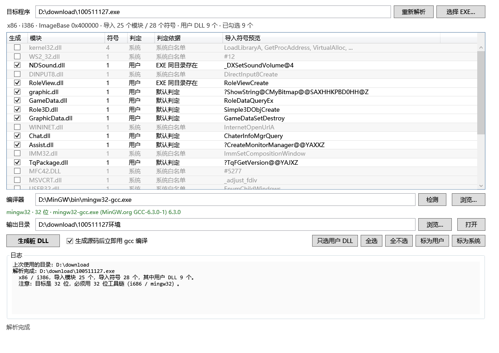

# PE 导出桩生成器（PeStubGen）

给 PECompact 加壳的 32 位 MFC 程序"补环境"用的小工具：读目标 EXE 的导入表，把**用户 DLL**（游戏自带的那些）找到，
为每个 DLL 生成一份只含导出、函数体为空的桩 DLL，让 Windows 加载器能过导入解析，从而走到壳的 OEP。

之后的 dump + Scylla 重建 IAT 是另外的事，这个工具不做，也不实现任何桩函数的行为——**桩被真正调用会崩**，这是设计目的。



## 快速开始

```powershell
powershell -ExecutionPolicy Bypass -File .\build.ps1
```

编译产物在 `out\`：

| 文件 | 用途 |
|---|---|
| `out\PeStubGen.exe` | 图形界面（双击运行） |
| `out\PeStubGen.Cli.exe` | 命令行版（批处理 / 自测用） |

不需要安装 .NET SDK：直接用 Windows 自带的 .NET Framework 4.8 编译器 `csc.exe` 编译。

## 使用步骤

1. 把目标 EXE 拖进窗口，或者点「选择 EXE…」；
2. 工具自动解析导入表，把模块分成「系统」和「用户」两类，**用户 DLL 默认勾选**；
3. 确认编译器（默认在 PATH 里找 gcc，也可以手动指定），下面会显示它的目标位数；
4. 点「生成桩 DLL」。

输出目录默认是 `<EXE 所在目录>\<EXE 文件名去扩展名>环境\`，例如样本：

```
D:\download\100511127环境\
├── RoleView.dll      ← 9 个桩 DLL，平铺放
├── graphic.dll
├── ...
├── src\              ← 每个 DLL 一份 .c + .def
│   ├── RoleView.c
│   └── RoleView.def
├── build.log         ← gcc 的原始输出
└── manifest.json     ← 源 EXE 的 SHA256、每个桩的导出清单、成功/失败
```

把 `100511127环境\` 里的 DLL 拷到 EXE 同目录再运行，报错应该从「无法定位程序输入点」变成不报（或者变成壳自己在抱怨文件损坏——那就不是桩的问题了）。

## 系统 DLL / 用户 DLL 怎么判

按优先级：

1. **手动指定**（表格里选中行 →「标为用户」/「标为系统」）最优先；
2. 命中**系统 DLL 白名单**（kernel32、user32、gdi32、advapi32、ole32、ws2_32、msvcrt、mfc42、msvcp60、dinput8 ……）；
3. 在 `%SystemRoot%\SysWOW64`（32 位目标）或 `System32`（64 位目标）里**存在同名文件**；
4. 剩下的算用户 DLL。

注意 MFC42 / MSVCP60 / MSVCRT 在 SysWOW64 里都有，会被判成系统、不生成——这是对的，它们必须用系统那份。

## 生成的东西长什么样

`RoleView.def`（导出名必须和导入表逐字节一致）：

```def
; 自动生成，请勿手工修改：仅为满足 Windows 加载器解析导入表。
; 源模块：RoleView.dll
LIBRARY RoleView.dll
EXPORTS
    RoleViewCreate=stub_1
```

C++ 修饰名（含 `?` `@`）会整体加引号，因为 GNU ld 把行内的 `@` 当作"序号"语法：

```def
    "?ShowString@CMyBitmap@@SAXHHKPBD0HH@Z"=stub_1
```

按序号导入的符号只导出序号、不带名字：

```def
    stub_1 @5277 NONAME
```

`RoleView.c` 就是一堆空函数：

```c
void stub_1(void) {}
```

编译命令（工具内部执行，工作目录是纯 ASCII 的临时目录）：

```
mingw32-gcc -shared -s -o RoleView.dll RoleView.c RoleView.def
```

## 自测结果（样本 `D:\download\100511127.exe`）

| 项目 | 结果 |
|---|---|
| 位数 | x86 / i386，ImageBase 0x400000 |
| 导入模块 / 符号 | **25 / 28**（总结里写的 26 是笔误，用 objdump 交叉核对过是 25） |
| 用户 DLL | **9 个**：NDSound、RoleView、graphic、GameData、Role3D、GraphicData、Chat、Assist、TqPackage |
| 编译结果 | 9/9 成功，全部 32 位（`pei-i386`） |
| 导出校验 | 生成后**读回桩 DLL 的导出表**与原导入表逐项比对，9/9 完全一致 |
| 独立复核 | 用 MinGW 的 `objdump -p` 再看一遍，导出名逐字节相同，含 `?ShowString@CMyBitmap@@SAXHHKPBD0HH@Z` 这类名字 |

## 命令行

```text
PeStubGen.Cli.exe parse   <exe>      # 只看导入表
PeStubGen.Cli.exe classify <exe>     # 看系统/用户判定
PeStubGen.Cli.exe exports <dll>      # 读 DLL 的导出表
PeStubGen.Cli.exe probe   [--gcc <path>]
PeStubGen.Cli.exe gen     <exe> [--out <dir>] [--no-compile] [--gcc <path>] [--dll a.dll,b.dll]
```

图形界面还带两个自动化入口（不弹窗，给脚本用）：

```powershell
.\out\PeStubGen.exe --auto <exe> [输出目录]        # 走完整界面流程，把日志打到 stdout
.\out\PeStubGen.exe --shot <png> [exe] [宽] [高]    # 离屏渲染界面截图
```

## 实现上的几个选择

- **.NET Framework 4.8 + csc，没有 .NET SDK**：这台机器只装了 .NET 8 运行时，没有 SDK；4.8 的 `csc.exe` 现成可用。
  代价是只能用 C# 5（没有字符串插值、`?.`、`record`），界面也就没用 XAML，全部用代码搭。
- **PE 解析是自己写的**（`src/PeFile.cs`、`PeImports.cs`、`PeExports.cs`），没引 PeNet：机器没网，NuGet 拉不到包。
  实现覆盖 PE32/PE32+、普通导入、延迟导入、按序号导入。
- **编译器探针按 triple 判位数**，不看文件名：这台机器的 `gcc.exe` 名字里没有 `i686`，但 `-dumpmachine` 是 `mingw32`，
  就是 32 位。反过来，如果 PATH 里是 `x86_64-w64-mingw32-gcc`，编 32 位程序会被直接拒绝。
- **编译在临时目录里做**，成功了再把 DLL 拷回中文输出目录。
  这是为了绕开老版本 gcc / ld 对非 ASCII 路径的处理问题（`D:\download\100511127环境` 这种）。
  临时目录按 `%TEMP%` → 系统盘 `\PeStubGenTemp` → `输出目录\.buildtmp` 的顺序**实际探测可写性**再选用，
  同时把 `TMP`/`TEMP`/`TMPDIR` 指向同一个目录，这样即使系统的临时目录不可写，gcc 也照样能干活。
- **自校验**：每个 DLL 编译完都会读回自己的导出表，和导入表比对，缺一个或多一个都算失败，
  不会出现"看着生成了其实不对"的情况。
- `ProcessStartInfo.ArgumentList` 是 .NET Core 才有的，net48 没有，所以自己写了 `QuoteArg()` 做命令行转义。

## 已知限制

- 桩函数被调用必崩。它的唯一职责是让加载器解析通过。
- 部分 PECompact 版本有 IAT 加密或自校验，加载过了之后仍可能在壳里报"文件损坏"——这不是桩能解决的。
- 导入表损坏或为空时会明确报错，不会生成一个空目录。
- 导入名如果是非 ASCII 字节，会被当作 Latin-1 写进 `.def`（实际样本里没有这种）。
- 64 位目标需要 x86_64 工具链，本机没有；32 位样本用不上。

## 故障排查

| 现象 | 处理 |
|---|---|
| 「编译器不可用」 | 手动指定 `gcc.exe` 路径，或用「检测」看它的 triple 和位数 |
| 位数不符 | 32 位程序必须用 32 位编译器（`mingw32` / `i686-*`） |
| 某个 DLL 编译失败 | 看 `build.log` 里那个 DLL 的 gcc 输出；多数是 .def 里的符号名有异常字符 |
| 加载器还报缺导出 | 打开 `manifest.json` 看 `verified` 是不是 true；再确认拷进 EXE 目录的是不是新生成的那份 |
